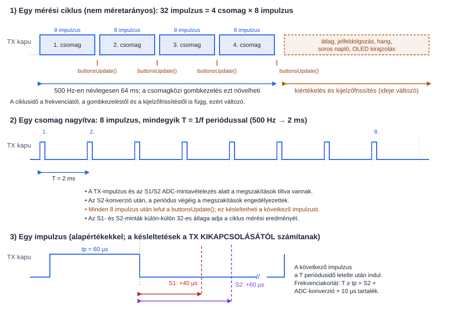

# Wallscout – impulzus-indukciós (PI) betonvas-kereső firmware

ATmega328P (16 MHz), DD tekercs-elrendezés, SSD1306 128x64 OLED, 2 gomb, passzív buzzer.
Build: PlatformIO (`pio run`), az U8g2 könyvtárat a `platformio.ini` húzza be.

## 1. Hardver (a kapcsolási rajz alapján)

| Funkció | Láb | Megjegyzés |
|---|---|---|
| TX MOSFET (Q2, IRLZ44N) kapu | PD2 | aktív magas, 100 Ω soros + 10 kΩ lehúzó |
| Buzzer (Q1 2N2222 bázis) | PD3 = OC2B | Timer2 Fast PWM |
| SW2 „Nullázás” | PD4 (PCINT20) | aktív alacsony, belső felhúzás |
| SW1 „Kalibrálás” | PD5 (PCINT21) | aktív alacsony, belső felhúzás |
| Vevőjel (Rx) | PC0 = A0 | az MCP6004 U2A/U2B (2 × ~11×, össz. ~121×) + U2D kimenete, nyugalmi szint Vmid = Vcc/2 |
| Tápfeszültség | PC1 = A1 | R11 100k / R12 33k osztó → Vin = Vadc · 133/33 |
| OLED SDA / SCL | PC4 / PC5 | hardveres I2C, 400 kHz |
| Soros napló | PD0 / PD1 | a rajzon nincs kivezetve, USB-soros átalakítót kell rá kötni (115200 baud) |

A kijelző a kódban 128x64-es (`U8G2_SSD1306_128X64_NONAME_1_HW_I2C`). A rajzon szereplő ER-OLEDM0.91 128x32-es; ha ilyet használsz, a konstruktort kell cserélni a `ui.cpp`-ben.

## 2. A mérés elve és megvalósítása (`measure.cpp`)

PI fémkeresőnél a TX tekercsbe rövid áramimpulzust adunk, majd lekapcsoljuk. A tekercs lecsengésekor a közeli fémben örvényáram indul, ami lassítja a vevőjel lecsengését. Ezt a lecsengést két, a lekapcsolás után késleltetett időpontban mintavételezzük:

```
TX:  ____|‾‾‾‾‾‾‾|__________________________
         0      tp   tp+tS1   tp+tS2     period
                      S1       S2

```


* **S1** – korai minta (`tS1`, alapérték és minimum 40 µs): a tekercsáram lecsengése után vett minta; a minimumot úgy választottuk, hogy 12 V-on, 60 µs impulzusnál (számított lecsengés ≈ 28 µs, lásd lentebb) se essen a lecsengésbe.
* **S2** – késői minta (`tS2`, alapérték 60 µs): csak a lassan lecsengő (nagyobb, vasas) válaszok maradnak benne.
* A fém jelenléte az S1 (és S2) nullázott értékének eltolódásaként látszik.

**Időzítés:** egy impulzus alatt a megszakítások tiltottak (`cli()`), az időt a Timer1 adja (előosztó 1, 1 tick = 62,5 ns). A Timer1 a TX bekapcsolásakor nullázódik, a kódban aktív várakozás (`while (TCNT1 < …)`) biztosítja az időpontokat, így nincs megszakítás-jitter.

**ADC:** közvetlen regiszterprogramozás, előosztó 16 → 1 MHz ADC órajel, konverzió 13 µs. Az ADC a konverzió indítása után 1,5 ADC órajellel mintavételez, ezért a konverziót ennyivel (`ADC_SAMPLE_TICKS` = 24 tick) korábban indítjuk, hogy a valódi mintavétel pontosan `tS1`, illetve `tS2` időnél legyen. Az S2 konverzió csak az S1 befejezése után indul, ezért `tS2 ≥ tS1 + 16 µs` (a Beállítások kikényszeríti). A névleges 200 kHz feletti ADC órajel pontosságát az átlagolás ellensúlyozza.

**Átlagolás:** egy ciklus 32 impulzus átlaga (500 Hz-nél ~64 ms); a nullázás normál ciklusokat futtat, amíg a jel meg nem áll (lásd 5. fejezet). Az impulzusokat 8-as csomagokban futtatjuk, a csomagok között a gombokat pollozzuk (a megszakítások az impulzusok közti várakozás alatt engedélyezettek, hogy a `millis()` pontos maradjon).


### 2.1. Az időzítési paraméterek jelentése, számítása és korlátai

**Mitől értendők az értékek?**

| Paraméter | Mettől számít | Jelentés |
|---|---|---|
| Impulzus (`tp`) | a TX bekapcsolásától (a Timer1 nullázásától) | a TX bekapcsolva tartásának ideje |
| S1 késleltetés (`tS1`) | a **TX lekapcsolásától** | a korai mintavétel időpontja |
| S2 késleltetés (`tS2`) | a **TX lekapcsolásától** | a késői mintavétel időpontja |
| Frekvencia (`f`) | – | az impulzusok ismétlési frekvenciája, a periódus `T = 1/f` |

Az S1 és az S2 késleltetés **ugyanabból a pillanatból**, a TX lekapcsolásától indul, nem egymás után: `tS2 = 60 µs` azt jelenti, hogy a lekapcsolás után 60 µs-mal történik a mintavétel, nem az S1 után 60 µs-mal. A Timer1 a TX bekapcsolásától számol, ezért a mintavételek a Timer1 szerint `tp + tS1`, illetve `tp + tS2` időnél vannak.

**Újraszámítás tick-ekre** (`measureConfigure()`, 16 MHz-en 1 µs = 16 tick; a Beállítások módosítása után minden alkalommal lefut):

```
g_tpTicks     = tp · 16
g_t1Ticks     = tp · 16 + tS1 · 16 − ADC_SAMPLE_TICKS     (az S1 konverzió indítási ideje)
g_t2Ticks     = tp · 16 + tS2 · 16 − ADC_SAMPLE_TICKS     (az S2 konverzió indítási ideje)
g_periodTicks = 16 000 000 / f                            (a periódus hossza)
```

Az `ADC_SAMPLE_TICKS` (24 tick = 1,5 µs) az ADC konverzió-indítása és a tényleges mintavétel közti késés, ezért a konverziót ennyivel korábban indítjuk. A legnagyobb érték (`tp + tS2` = 150 + 800 µs = 15 200 tick) belefér a Timer1 16 bitjébe (max. 65 535 tick = 4,1 ms).

**Egy periódus időrendje:**

```
t = 0                  TX BE, Timer1 = 0
t = tp                 TX KI
t = tp + tS1 − 1,5 µs   S1 konverzió indul  → kész: ~tp + tS1 + 11,5 µs
t = tp + tS2 − 1,5 µs   S2 konverzió indul  → kész: ~tp + tS2 + 11,5 µs
t = T                  a következő impulzus (a hátralévő időt várakozás tölti ki)
```

**Korlátok (amiket a Beállítások kikényszerít, `settingsSanitize()`):**

1. **Tartományok:** impulzus 20…150 µs, S1 40…120 µs, S2 60…800 µs, frekvencia 250…2500 Hz.
2. **S2 az S1 után:** a két konverzió nem fedheti egymást, mert az ADC egy időben csak egy konverziót végez, ezért `tS2 ≥ tS1 + 16 µs` (13 µs konverzió + 3 µs tartalék, `MIN_S_GAP_US`). Ha S1 növelése ezt megsértené, az S2 automatikusan feljebb ugrik.
3. **Bele kell férnie a periódusba:** a teljes mérésnek (impulzus + S2 késleltetés + az S2 konverzió ideje + tartalék) a `T` periódus alá kell esnie. Különben a következő impulzus csak a mérés végén indulhat, és a tényleges frekvencia a beállítottnál kisebb lenne (a mérés ráadásul csendben elcsúszna). Ezért a frekvencia felső határa:

   ```
   f_max = min(2500, 1 000 000 / (tp + tS2 + 13 + 10))   [Hz; a µs-értékekkel]
   ```

   (13 µs az ADC konverzió, 10 µs a `PERIOD_MARGIN_US` tartalék.) Példák: 60 µs impulzus + 60 µs S2 → `f_max` = 2500 Hz; 60 µs + 400 µs → ~2100 Hz; 150 µs + 800 µs → ~1000 Hz; 60 µs + 800 µs → ~1130 Hz.
4. **A frekvencia alsó határa 250 Hz:** 16 MHz-en a 16 bites Timer1 periódus-számlálója `16 000 000 / 250` = 64 000 tick-ig (4 ms) fér be (a maximum 65 535).
5. **Az S1 minimuma (40 µs) a tekercsáram lecsengéséből adódik.** Egyszerű modell (L = 1 mH, tp = 60 µs, a tekercs és a MOSFET ellenállását elhanyagolva, tehát felső becslés): a csúcsáram `I ≈ U·tp/L` = 0,54 A (9 V) … 0,72 A (12 V), a lecsípés (≈ 38 V) miatti lecsengési idő `t ≈ U·tp/(U_lecsípés − U)` ≈ 19 µs (9 V) … 28 µs (12 V). A 40 µs ezt ~1,4× tartalékkal fedi. Hosszabb impulzusnál vagy alacsonyabb lecsípésnél a lecsengés tovább tart (arányos tp-vel), ilyenkor az S1-et növelni kell. A szám számított, nem mért érték: szkóppal ellenőrizendő (Rx jel a „TX folyamatos" móddal).

**Mi történik módosításkor?**

A fenti korlátokat a `settingsSanitize()` ([src/settings.cpp](src/settings.cpp)) kényszeríti ki. Ez lefut minden beállításmódosítás után (`settingsAdjust()`), betöltéskor (`settingsLoad()`) és mentéskor (`settingsSave()`). A frekvencia felső határát a `freqLimitHz()` számolja. A korrekció csendben történik, a kijelzőn nincs jelzés.

* Az impulzus vagy az S2 növelése csökkentheti a frekvencia felső határát; ha a beállított frekvencia a határ fölé kerülne, a firmware automatikusan a határra csökkenti.
* Az S1 növelése szükség esetén az S2-t is feljebb viszi (`tS2 ≥ tS1 + 16`), ami szintén csökkentheti a frekvencia felső határát.
* A frekvencia léptetése a mindenkori felső határnál ugrik vissza a minimumra (250 Hz).
* Minden módosítás után a mérés új időzítéssel (`measureConfigure()`) folytatódik, és a Beállítások elhagyásakor új nullázás következik, mert a nyugalmi jelszint a paraméterekkel együtt változik.
* A mérési ciklus ideje (32 impulzus) a frekvenciával fordítottan változik (500 Hz: ~64 ms, 2500 Hz: ~13 ms); a tényleges soros naplózási és kijelzési ütem a kijelző rajzolási idejétől függ, ezért ~5–6 Hz marad.
* A **TX folyamatos** menüpont (lásd 4. fejezet) ugyanezekkel a `tp` és `f` értékekkel fut, és a módosításuk azonnal érvényesül.

### 2.2. A felpörgetett ADC és a beállítható időértékek összeegyeztethetősége

Az ATmega328P ADC-je a datasheet szerint 50…200 kHz ADC órajelen ad teljes (10 bites) felbontást. A firmware az előosztót 16-ra állítja (`ADC_PRESCALER`), így az ADC órajele 16 MHz / 16 = **1 MHz**, vagyis a névleges tartomány fölött jár. Ennek oka, hogy a konverzió (13 órajel = 13 µs) így elég gyors ahhoz, hogy a lecsengés korai szakaszában két mintát vegyünk. A beállítható időértékek és az ADC együttműködése:

* **A konverzió időzítése pozitív marad.** A konverzió indítása és a tényleges mintavétel közt 1,5 ADC órajel (1,5 µs, 24 CPU ciklus) telik el, ezért az indítást `ADC_SAMPLE_TICKS`-szel korábbra tesszük. A legkisebb beállítható késleltetés `tS1 = 40 µs`, így az indítási időpont `tp + 40 − 1,5 = tp + 38,5 µs`, azaz mindig az impulzus lekapcsolása után van (a TX kikapcsolása előtt soha nem indul konverzió).
* **A két konverzió nem fedi egymást.** Az ADC egy időben egyetlen konverziót végez (13 µs). Az S2 konverzió indítása `tS2 − 1,5 µs`, az S1 befejezése `tS1 − 1,5 + 13 µs`, ezért kell `tS2 ≥ tS1 + 16 µs` (13 µs konverzió + 3 µs tartalék). A `settingsSanitize()` ezt minden módosításnál kikényszeríti, szükség esetén az S2-t feljebb viszi.
* **A hosszú késleltetések nem okoznak gondot.** Az S2 800 µs-ig állítható. Az ADC a konverzió indításáig nem fut, a mintavétel pillanatát kizárólag a Timer1-es várakozás határozza meg, ezért a hosszú várakozás nem befolyásolja az ADC működését vagy pontosságát. A korlát nem az ADC, hanem a periódus (lásd 2.1).
* **Az indítási bizonytalanság kicsi.** Az ADC előosztója szabadon fut, ezért a konverzió valójában a következő ADC órajel-élnél indul: ez legfeljebb 1 ADC órajelnyi (1 µs, 16 CPU ciklus) bizonytalanság a mintavétel idejében. A lassan lecsengő jelnél ez elhanyagolható, a legkorábbi (40 µs körüli) mintáknál, ahol a lecsengés meredek, kismértékű szórást okozhat. Ezt az impulzusonkénti mintavétel azonos fázisa (a Timer1 mindig nullázott) és a 32 impulzusos átlagolás csökkenti.
* **A felbontásromlást az átlagolás ellensúlyozza.** 200 kHz fölött az ADC effektív felbontása csökken (a datasheet szerint ~1 MHz-nél kb. 8 bit körüli), a kisebb jelek zajosabbak lehetnek. A 32 impulzus átlagolása (~√32 ≈ 5,7× zajcsökkenés) ezt kompenzálja. A nullázott (`s1`, `s2`) érték így is csak néhány ADC egység nagyságú jelet tud megbízhatóan kimutatni, ezért vannak a detektálási küszöbök (`DETECT_ON_COUNTS` / `DETECT_OFF_COUNTS`).
* **Forrásimpedancia.** A mintavevő kondenzátor feltöltésére 1,5 ADC órajel jut (1,5 µs). Az Rx jelet az U2B erősítő kimenete adja (alacsony kimeneti impedancia), ezért ez rendszerint nem korlátoz. Ha a legkorábbi minta (kis `tS1`) szórása szokatlanul nagy, ez is gyanúsítható.
* **Ha gond van az ADC-vel.** Ha a kis jelek túl zajosak vagy a korai minta szór, az előosztó 32-re emelhető (`ADC_PRESCALER 32`, `ADC_PS_BITS` = `_BV(ADPS2) | _BV(ADPS0)`). Ekkor 0,5 MHz az ADC órajele, a konverzió 26 µs, a mintavétel 3 µs-mal az indítás után van, és az S1–S2 minimális távolság is nagyobb lesz (~29 µs). Az `ADC_SAMPLE_TICKS`, `ADC_CONV_US` és a `MIN_S_GAP_US` a `config.h`-ban az `ADC_PRESCALER`-ből számolódik, de a frekvenciahatár (2.1) és az itt említett értékek ilyenkor újra ellenőrzendők.

**Telítés:** ha az impulzusok több mint negyedénél az ADC érték ≤ 4 vagy ≥ 1019, a Keresés képernyőn „TELITES!” jelenik meg (a trimmerekkel kell finomítani).

## 3. Jelfeldolgozás (`main.cpp`)

* `base1`, `base2`: a nullázáskor mért S1, S2 átlag.
* `s1 = S1 − base1`, `s2 = S2 − base2`: **előjeles jel** (ADC egység; 1 egység ≈ 40 µV a bemeneten a ~121× erősítés mellett).
* `dd = S1 − S2` (nyers, nem nullázott): a DD képernyő nullponti jele.
* **Jelerősség:** `s1` (a kijelzőn előjelesen, a sávon abszolút értékben).
* **Csúcs-megtartás és lecsengés:** a legnagyobb |s1| 0,5, másodpercig (`PEAK_HOLD_MS`) változatlanul látszik a sávon függőleges jelzőként, utána exponenciálisan lecseng az aktuális jelszint felé (időállandó 1 s, `PEAK_DECAY_MS`). Új, nagyobb csúcsnál a jelző azonnal felugrik. Így a jelző mozgásából követhető, merre és mennyit változik a jel.
* **Találat (hiszterézissel):** a találat akkor kapcsol be, ha |s1| ≥ 4 egység (`DETECT_ON_COUNTS`), és csak akkor kapcsol ki, ha 2,5 egység alá csökken (`DETECT_OFF_COUNTS`). A két küszöb közti sávban az állapot változatlan marad, így a zajszint körüli jel nem billegteti a találatot, a mélységbecslést, a fém-jelleget és a hangot. A találat-állapot nullázáskor törlődik. **Kijelzett érték:** a KERESES nagy száma és sávja (valamint a GRAFIKON fejléc száma) találat nélkül 0-t mutat, találatnál a valós előjeles értéket (`UiData::shown`); így nyugalomban a zaj nem billegteti a számot. A soros napló és a grafikon görbéje továbbra is a nyers értéket használja, a csúcsjelző is a nyers amplitúdót követi.
* **Fém-jelleg (heurisztika):** az `s1` előjele dönt: `s1 > 0` → „Fe (vas)”, `s1 < 0` → „nFe (szines)”. Ez mérésen alapul: a fogó (vas) +44…+80, a bronz −26…−38 egységet adott, az `s2/s1` arány viszont a bronznál 0 és 1 között ugrált, ezért az előző arányos szabályt (`RATIO_FERROUS`) elhagytuk. Korlát: erős vas-találat után a jel rövid ideig negatív irányba lecseng (−3…−5), ilyenkor a kijelzés rövid időre „nFe”-re válthat.
* **Mélységbecslés:** `d = d_ref · (A_ref / |s1|)^(1/3)`. A kitevő (3) a `DEPTH_EXPONENT` konstans. Kalibráció nélkül az alapértelmezett `A_ref = 60` egységet használja a 30 mm-hez, ezt `~35mm?` jelzi (a „?” = kalibrálatlan). Kalibráció után `35mm` jelenik meg. Zajszint alatt „--mm”, 150 mm felett „>150mm”.
* **Aktivitás:** gombnyomás, vagy a jel (DD képernyőn a `dd`) több mint 8 egységnyi változása.

## 4. Kezelés

| | Kereső csoport | Beállító csoport |
|---|---|---|
| Képernyők | **KERESES** ↔ **GRAFIKON** | **DD BEALLITAS** ↔ **BEALLITASOK** |
| SW1 rövid | váltás a két képernyő között | váltás a két képernyő között |
| SW2 rövid | újranullázás | Beállításokban: következő elem (DD-n nincs funkció) |
| SW1 hosszú | mélység-kalibráció | Beállításokban: a kijelölt elem értékének léptetése (nyomva tartva ismétlődik, a végén a minimumra ugrik) |
| SW2 hosszú | belépés a beállító csoportba (DD BEALLITAS) | **kilépés**: mentés, új időzítés alkalmazása, nullázás, KERESES |

Minden képernyő jobb felső sarkában a tápfeszültség látszik; 7,0 V alatt villogva, inverzen.

### Képernyők

* **KERESES:** előjeles jelérték nagy számmal (csak a negatív érték kap „−” jelet, a „+” helye üresen marad, így a szám nem ugrál; a 0 mindig előjel nélkül jelenik meg), becsült mélység, fém-jelleg, jelerősség-sáv csúcs-jelzővel, alul állapotsor: bal oldalt `Nincs jel` vagy `TELITES!`, jobb oldalt mindig a `Skala: N` felirat (jobbra igazítva, így a sor nem ugrál).
* **GRAFIKON:** a jelerősség az idő függvényében (128 minta, kb. 20 s). A felső sorban a cím után a mód jelzése (`ABS` / `SIG`), jobbra igazítva a legfrissebb mért érték, a jobb szélen a tápfeszültség. Két mód van (Beállítások → *Grafikon*, alapértelmezés: `ABS`):
  * **ABS** – a jel abszolút értékét mutatja (a felső szám is előjel nélküli). A nullvonal a kijelző legalsó során (63. pixel) van, a teljes skála 49 pixel (a 14. sorig), így a teljes grafikon-magasság használható; a felső határt ritkán pöttyözött vonal jelzi.
  * **SIG** – előjeles megjelenítés: a nullvonal a 38. pixelen, a ±teljes skála ±24 pixel, mindkét határt ritkán pöttyözött vonal jelzi.

  A skála az érzékenységi fokozatból adódik. A mód vagy az érzékenység váltásakor az előzmények törlődnek, mert más pixel-skálán készültek.
* **DD BEALLITAS:** nagy előjeles szám (`S1 − S2`) balra igazítva, tőle jobbra `NULL OK` jelzés, ha a simított érték a nullpont közelében van. A jelzés 2 ADC-egységnél kapcsol be, és csak 3 egység fölött kapcsol ki, így nem villog a küszöb körüli zaj miatt. A vízszintes sáv közepe a nullpont; a kijelzett értéket enyhe aluláteresztő szűrő simítja, a soros napló továbbra is a nyers mérést mutatja. A sáv skálája automatikusan választott (±10 … ±1000); a `+−10` például azt jelenti, hogy a sáv közepe 0, bal széle −10, jobb széle +10 ADC-egység. Az alsó sor folyamatosan a pillanatnyi S1/S2 nyers ADC-átlagot és a skálát mutatja. A sáv iránya mutatja, merre kell a tekercseket állítani. Közben a buzzer hangmagassága a nullponttól való távolsággal nő (a nullpont közelében elnémul). Magyarázat: a megfelelő geometriai átfedésnél az adó- és vevőtekercs közti közvetlen csatolás minimális, a nullpont két oldalán a kölcsönös induktivitás előjele ellentétes. A nullpont tehát az az állapot, ahol az S1 és S2 minta különbsége minimális, a konkrét időzítés és analóg jelút mellett.
* **BEALLITASOK:** elemek:
  1. *Impulzus* (20…150 µs, 10 µs-es lépés, alap 60)
  2. *Frekvencia* (250…2500 Hz, 50 Hz-es lépés, alap 500; a felső határ automatikusan csökken, ha az impulzus + S2 késleltetés + ADC konverzió (13 µs) + 10 µs tartalék nem fér bele a periódusba, pl. 60 µs impulzus és 800 µs S2 mellett kb. 1130 Hz. Ha az impulzus vagy S2 növelése miatt a beállított frekvencia a határ fölé kerülne, az a határra csökken)
  3. *S1 keslelt.* (40…120 µs, 5 µs-es lépés, alap 40; a TX lekapcsolásától számítva)
  4. *S2 keslelt.* (60…800 µs, alap 60; a TX lekapcsolásától számítva, tehát S1-gyel egy időpontból indul; legalább S1 + 16; a lépés 100 µs alatt 5, 300 µs alatt 10, fölötte 20 µs)
  5. *Erzekenyseg* (1…6 kijelzési skála; nem módosítja az analóg erősítést, a TX impulzushosszt vagy az ismétlési frekvenciát)
  6. *Hang* (KI, 1…3; a kitöltési tényezővel szabályozott hangerő)
  7. *Kal. melyseg* (10…100 mm referencia-mélység, 5 mm-es lépés; módosítása érvényteleníti a kalibrációt)
  8. *Grafikon* (SW1 hosszan: váltás `ABS` ↔ `SIG` között; alapértelmezés `ABS`)
  9. *TX folyamatos* (SW1 hosszan: `KI` ↔ `BE`, mint a többi elemnél; a TX tekercs csillapításának szkópos beállításához. `BE` állapotban a beállított impulzushosszal és frekvenciával szakadatlanul, csomagolás és mintavétel nélkül megy az impulzussor, így a szkóp stabilan ráhangolható. Közben lehet más menüelemre lépni (SW2), és az *Impulzus* és *Frekvencia* elemet állítani (SW1 hosszan): a változás azonnal hat az impulzusokra, az impulzussor csak a kijelző újrarajzolásakor szakad meg rövid időre. Az állapot nem tárolódik: a Beállításokból való kilépéskor (vagy alváskor) leáll, és visszaáll a csomagonkénti működés. Közben a készülék nem alszik el magától, ezért a teszt után kapcsold ki vagy lépj ki.)
  10. *Reset* (SW1 hosszan: visszaállítás; a „GYARI ERTEKEK” üzenet rövid ideig látszik, utána mentés, nullázás és visszatérés a KERESES képernyőre)

A beállítások a beállító csoportból való kilépéskor (vagy alvás előtt) az EEPROM-ba kerülnek (CRC védelemmel).

#### Kijelzési érzékenység / skála

| Fokozat | Teljes skála (ADC-egység) | Megjelenítés |
|---|---:|---|
| 1/6 | 500 | Legkevésbé érzékeny; azonos jel kisebb sávkitérést és kisebb grafikon-kilengést okoz. |
| 2/6 | 250 |  |
| 3/6 | 120 | Alapértelmezett fokozat. |
| 4/6 | 60 |  |
| 5/6 | 30 |  |
| 6/6 | 15 | Legérzékenyebb; azonos jel nagyobb sávkitérést és nagyobb grafikon-kilengést okoz. |

Az alacsonyabb kijelzési érzékenység **kevésbé rángatózóvá teheti a sávot, a grafikont és a hangmagasságot**, mert ugyanaz a jel kisebb kitéréssé skálázódik. Magát a nyers mérést és annak zaját nem csökkenti. A Keresés nagy, előjeles számértéke, a mélységbecslés és a fémjelzés sem változik a fokozattal; ezekhez valódi jelszűrésre vagy eltérő feldolgozásra lenne szükség. Ez tehát kijelzési skála, nem a hardver érzékenységét vagy az impulzusprofilt módosító üzemmód.

### Mélység-kalibráció

1. A Beállításokban állítsd be a referencia-mélységet (pl. 30 mm).
2. Tartsd az eszközt ismert, ennyire lévő vas fölé (a nullázás után, fémmentes helyen).
3. A KERESES vagy GRAFIKON képernyőn nyomd hosszan az SW1-et. Az aktuális |s1| lesz a referencia-amplitúdó, az EEPROM-ba mentődik.

### Hang

A jelerősséggel arányos hangmagasság (500…3000 Hz) a Timer2 Fast PWM kimenetén (OC2B, PD3). A hang a találat-állapot fennállása alatt szólal meg (hiszterézissel: 4 egység fölött kezdődik, 2,5 alatt áll le). A hangerőt a kitöltési tényező (6 % / 20 % / 50 %) adja.

## 5. Nullázás, alvás, ébredés

* **Bekapcsoláskor** a logó után automatikusan nullázás (adaptív nullázás, lásd lent), majd a KERESES képernyő.
* **Nullázás közben** (fémmentes helyen tartsd a tekercset!) a „NULLAZAS...” keretes felirat a kijelző közepén látszik, a KERESES és a GRAFIKON képernyőn is ugyanazzal a kóddal (`drawZeroingBox`), a mögötte lévő rajz fölött. A nullázás alatt is az aktív mérő képernyő (KERESES vagy GRAFIKON) frissül (nem statikus üzenet), mert mérésekkel igazolt, hogy statikus üzenetkép mellett a nullpont ~3–5 ADC egységgel magasabb jelszinten készült, mint normál üzemben (a kijelző/tápterhelés változása a vevő referenciáját eltolta), ezért nullázás után az érték −1…−3-ra állt be és lassan visszacsengett. A normál kép rajzolásával a nullázás ugyanazon a terhelésen fut, és a nullázás utáni `s1` a zajszinten (±0,5 egység) marad. A nullázás normál mérési ciklusokat futtat (32 impulzus, közben kijelző-frissítés), és addig tart, amíg a jel meg nem áll: a legutóbbi `ZERO_WINDOW` (6) ciklus S1 értékeinek max−min különbsége `ZERO_STABLE_COUNTS` (1,6 egység) alá kerül. A nullpont ennek a stabil ablaknak az átlaga. Ha a jel nem áll meg, `ZERO_MAX_CYCLES` (40, kb. 7 s) után a legutóbbi ablakot használja. A stabilitásra várás a gombnyomás utáni átmeneti ingadozást is kivárja. A nullázás ezért kb. 1,5–7 s. Tanulság: a nullázás körülményeinek (kijelzőterhelés) meg kell egyezniük a normál üzemével, különben a nullpont eltolódik. Ezért a KERESES↔GRAFIKON váltáskor (SW1) automatikus nullázás van, amely az újonnan megjelenő képernyő rajzolása mellett fut (a grafikon előzménye is törlődik), így váltást fémmentes helyen végezz.
* **5 perc aktivitás nélkül** (nincs gomb, nincs jelváltozás) a készülék elmenti az esetleges beállításokat, kikapcsolja a kijelzőt és a hangot, az ADC-t, a BOD-ot, majd Power-down alvásba lép.
* **Ébredés:** bármelyik gomb (PD4/PD5 pin-change megszakítás). Az ébresztő nyomás nem vált ki műveletet; a készülék azonnal nulláz és a KERESES képernyőre lép.
* A megszakítás csak az alváshoz kell: mérés közben a megszakítások tiltottak, ébredés után a PCINT ki van kapcsolva, a gombokat pollozzuk.

## 6. Soros napló (115200 baud)

Indulás után fejléc és CSV sorok mérési ciklusonként (kb. 5–6 Hz):

```
# ms,scr,S1raw,S2raw,base1,base2,s1,s2,dd,peak,depth_mm,vbatt_mV,sat
```

| Mező | Jelentés |
|---|---|
| `scr` | képernyő: 0 KERESES, 1 GRAFIKON, 2 DD, 3 BEALLITASOK |
| `S1raw`, `S2raw` | nyers ADC átlag (0..1023, nyugalmi ~512) |
| `base1`, `base2` | nullázáskor eltárolt alapszint |
| `s1` | `S1raw − base1` (előjeles jel; a kijelzett jelerősség) |
| `s2` | `(S1raw − S2raw) − (base1 − base2)`, az S1 − S2 különbség nullázott megfelelője |
| `dd` | `S1raw − S2raw`, a DD képernyő jele |
| `peak` | csúcs-megtartott abszolút érték |
| `depth_mm` | becsült mélység; −1 nincs találat, −2 túl mély |
| `vbatt_mV` | tápfeszültség |
| `sat` | 1, ha az ADC telítésben van |

Eseménysorok `#`-tel kezdődnek: `# ZERO`, `# CAL`, `# SET …`, `# SLEEP`, `# WAKE`. A hangoláshoz érdemes a fém fölé húzva figyelni az `s1` előjelét és az `s1`/`S2raw` viszonyát (fém-jelleg küszöb), a `sat` jelzőt és az `S1raw`/`S2raw` nyugalmi értékeit (a trimmerek beállításához).

## 7. Forrásfájlok

| Fájl | Tartalom |
|---|---|
| `include/*.h` | konstansok (`config.h`: lábkiosztás, időzítések, küszöbök) és a modulok fejlécei |
| `src/main.cpp` | állapotgép, jelfeldolgozás, mélységbecslés, napló |
| `src/measure.cpp` | PI mérés, ADC, Timer1, tápfeszültség-mérés |
| `src/settings.cpp` | beállítások, EEPROM |
| `src/buzzer.cpp` | Timer2 hangkeltés |
| `src/buttons.cpp` | gombkezelés |
| `src/power.cpp` | mélyalvás, ébresztés |
| `src/ui.cpp` | OLED képernyők |

## 8. Ismert korlátok, hangolási teendők

* A mélységbecslés és a fém-jelleg közelítő modell; az `DEPTH_EXPONENT` és az alapértelmezett `CAL_AMP_DEF` a valós hardveren, a soros napló alapján hangolandó. A fém-jelleg csak az `s1` előjelén alapul, eddig egy vas (fogó) és egy színesfém (bronz) mérésével igazolva; más fémekkel (alumínium, réz, betonvas) még ellenőrizendő.
* A tápfeszültség-kijelzés pontossága a 7805 kimenetétől (ADC referencia) függ; szükség esetén a `VREF_MV` / `VBATT_OFFSET_MV` állítható. Ha a mért érték a bemeneti dióda miatt eltér a tápegységétől, az utóbbival korrigálható.
* A flash kihasználtsága ~90 %, új funkcióknál ezt figyelni kell.
* A mérés közben szóló buzzer (a meghajtás áramfelvétele) befolyásolhatja a vevőt, ami a hang ki-be kapcsolásakor billegő jelet adhat. Ha ez zavaró, csökkentsd a hangerőt vagy kapcsold ki a hangot (Beállítások → *Hang*).
* A feliratok ékezet nélküliek (a kijelző-betűkészlet nem tartalmaz ő/ű karaktert).
